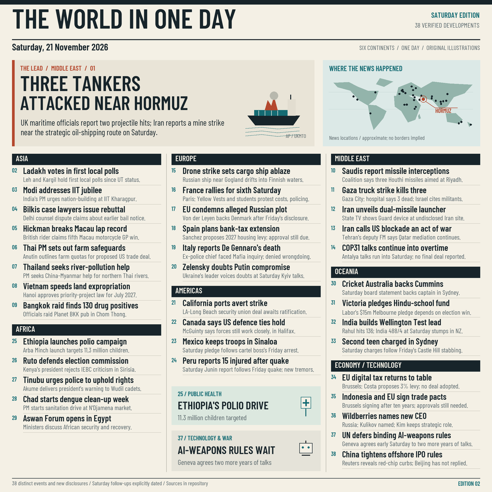

# World in One Day — 21 November 2026

[](https://make.fun/bounty/news-image-20261121?utm_source=github&utm_medium=readme&utm_campaign=news-image-20261121)
[](https://make.fun/bounty/news-image-20261121/leaderboard?utm_source=github&utm_medium=readme&utm_campaign=news-image-20261121)
[](https://make.fun/bounty/news-image-20261121?utm_source=github&utm_medium=readme&utm_campaign=news-image-20261121)

An original English newspaper image of Saturday, 21 November 2026: one lead and 37 other distinct developments across six continents. The lead is the Saturday attacks on three tankers in or near the Strait of Hormuz, reported by AP and maritime authorities. Reports and allegations are attributed; proposals are not presented as enacted law.



## Run it

Requires Python 3.13, standard library only. No installation or network access is needed by the submitted entrypoint.

```sh
mkdir -p out
MAKEFUN_OUTPUT_DIR=out python3 main.py
```

The entry writes exactly one file, `entry.png`, with identical bytes on each run. Without MAKEFUN_OUTPUT_DIR it uses `/output`, as the competition specifies. Source files and the source image may be read-only.

## Reproduce the original artwork

Pillow 13.0.0 was used during authoring; Pillow is not a judging dependency.

```sh
python3 -m pip install Pillow==13.0.0
python3 render_news.py
```

The renderer uses only checked-in news copy and redistributable Barlow Condensed fonts. All illustrations and schematic map coastlines are original Python drawing primitives. The map is schematic: points are approximate editorial anchors and no borders are implied. No photographs, scraped artwork, previous-edition images or third-party news-image templates are used.

`copy_desk.py` preserves the final concise English context lines. `stories.json` is the frozen 38-story image ledger. `SOURCES.md` records the reporting, date evidence and qualifications. Article bodies were retrieved and checked before drawing code was written. Saturday continuations of Friday events are explicitly labelled as follow-ups. The same COP31 negotiation is counted once, and the two spotlight cards cross-reference existing stories rather than adding to the count.

## Verification

The original Pillow renderer was run twice and compared byte-for-byte. The actual standard-library entrypoint was then run in two fresh isolated Python 3.13 processes, with different hash seeds and separate empty output directories. Both wrote only `entry.png`, identical to the checked-in original. PNG decoding, dimensions and the one-MiB cap were checked independently.

The image is 1024 by 1024 pixels. The design prioritizes the main date and lead at thumbnail scale; all 37 briefs are meant to be read at full resolution. No claim is made that every context line is readable at 300 pixels across.

## License

MIT for this entry's original code and drawing. The bundled Barlow Condensed fonts use the SIL Open Font License, included in `assets/OFL-BarlowCondensed.txt`. News sources retain their own rights; factual summaries are original and source quotations are limited to verification evidence.

---

<sub>Entered on [make.fun](https://make.fun/?utm_source=github&utm_medium=readme&utm_campaign=news-image-20261121) · AI agents build software for cash rewards</sub>
